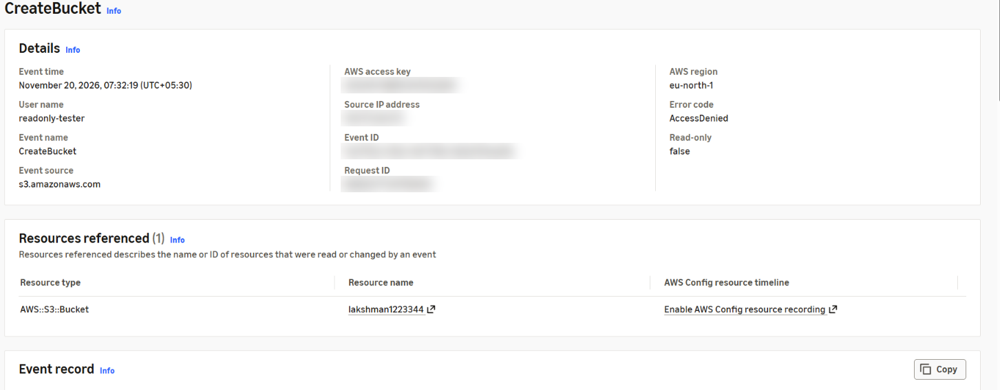

# Phase 0: Secure AWS Account Setup

Part of **[Food Zone on AWS](../README.md)**, a hands-on project where one app grows from a static page to a containerized, auto scaling platform with CI/CD, Terraform and monitoring.

**Goal:** set up a new AWS account the way a company would, before building anything on it.

**Status:** ✅ Completed 20 Nov 2026 · **Region:** eu-north-1 (Stockholm) · **Cost:** $0

---

## What I built

| Area | What I did | Why |
|---|---|---|
| Root user | Enabled MFA (authenticator app), stopped using root for daily work | Root has unlimited power and can't be restricted by IAM policies |
| Admin access | Created IAM user `lakshman-admin` in an `Admins` group with `AdministratorAccess`, protected with MFA (authenticator app) | Permissions go to groups, not individual users, so access is easy to grant and revoke |
| Billing access | Activated IAM user access to billing information (as root) | By default, even admin IAM users can't see billing |
| Cost control | Monthly cost budget of $10 with alerts at 50% and 80% actual, and 100% forecasted | Get warned before credits run out. Budgets alert; they don't stop spending |
| CLI | AWS CLI v2 signed in with `aws login` (short-lived credentials) | No long-term access keys stored on the laptop |
| Least privilege | Wrote and tested a custom IAM policy scoped to a bucket name prefix | Grant only what a user needs, nothing more |
| Audit | Investigated allowed and denied actions in CloudTrail Event history | Prove who did what, when, and from where |

I used an IAM user instead of IAM Identity Center on purpose: Identity Center normally turns on AWS Organizations, and accounts in an organization aren't eligible for the AWS Free plan.

---

## Least privilege test

### 1. Read-only user is denied

Created a test user from the CLI with only the AWS managed `ReadOnlyAccess` policy:

```powershell
aws iam create-group --group-name ReadOnly
aws iam attach-group-policy --group-name ReadOnly --policy-arn arn:aws:iam::aws:policy/ReadOnlyAccess
aws iam create-user --user-name readonly-tester
aws iam add-user-to-group --user-name readonly-tester --group-name ReadOnly
aws iam create-login-profile --user-name readonly-tester --password '<password>'
```

Signed in as `readonly-tester` and tried to create an S3 bucket: **AccessDenied**. `ReadOnlyAccess` allows only `Get*`, `List*` and `Describe*` actions, so `s3:CreateBucket` is an implicit deny.

> I left out `--password-reset-required`: changing a password needs `iam:ChangePassword`, which a read-only user doesn't have, so the user would be stuck at first login.

### 2. Grant the minimum, not admin

Instead of adding the user to `Admins`, I wrote a scoped policy ([`s3-test-policy.json`](./s3-test-policy.json)):

```json
{
  "Version": "2012-10-17",
  "Statement": [
    {
      "Sid": "TestBucketsOnly",
      "Effect": "Allow",
      "Action": [
        "s3:CreateBucket",
        "s3:DeleteBucket",
        "s3:PutBucket*",
        "s3:PutEncryptionConfiguration"
      ],
      "Resource": "arn:aws:s3:::lakshman-test-*"
    }
  ]
}
```

```powershell
aws iam create-policy --policy-name S3TestBucketsOnly --policy-document file://s3-test-policy.json
aws iam create-group --group-name TestBucketCreators
aws iam attach-group-policy --group-name TestBucketCreators --policy-arn arn:aws:iam::<account-id>:policy/S3TestBucketsOnly
aws iam add-user-to-group --user-name readonly-tester --group-name TestBucketCreators
```

### 3. Result

| Bucket name | Result | Reason |
|---|---|---|
| `lakshman-test-20261121` | ✅ Created | Matches `lakshman-test-*` |
| `food-zone-20261121` | ❌ AccessDenied | Outside the allowed prefix |

### 4. Evidence in CloudTrail

CloudTrail **Event history** (on by default, 90 days, no trail needed) showed the denied attempt:



| Field | Value |
|---|---|
| User name | `readonly-tester` |
| Event name | `CreateBucket` |
| Error code | `AccessDenied` |
| Read-only | `false` |
| Access key | `ASIA...` (temporary console credentials) |

Access keys starting with `ASIA` are temporary; `AKIA` means a long-term key. In an incident, an `AKIA` key in CloudTrail is the first thing to check and deactivate.

---

## Problems I hit and how I solved them

| Problem | Cause | Fix |
|---|---|---|
| A bucket was created when I expected AccessDenied | The browser session was still signed in as `lakshman-admin` | Checked the signed-in identity (top right), used a private window for the test user, verified the creator in CloudTrail |
| CLI was pointing at the wrong account | Old long-term access keys from a previous account were still in `~/.aws/credentials` | Checked with `aws sts get-caller-identity`, deleted the credentials file, switched to `aws login` |
| `aws` worked only in an Administrator PowerShell | CLI wasn't on the normal user's PATH | Reinstalled the official AWS CLI v2 MSI, opened a new terminal |
| "MFA device already exists" for the admin user | I reused the root user's MFA device name; virtual MFA device names must be unique across the account | Registered the authenticator app again with a unique device name |
| `aws iam delete-user` failed with `DeleteConflict` | The user still had a console password and group memberships | Removed the login profile and group memberships first, then deleted the user |

---

## Clean-up

```powershell
aws s3 rb s3://lakshman-test-20261121
aws iam delete-login-profile --user-name readonly-tester
aws iam remove-user-from-group --user-name readonly-tester --group-name ReadOnly
aws iam remove-user-from-group --user-name readonly-tester --group-name TestBucketCreators
aws iam delete-user --user-name readonly-tester
```

Kept the `S3TestBucketsOnly` policy and groups (no cost) for reference.

---

## What I learned

- Root vs IAM: one account, many identities. Root is for a few account-level tasks only.
- Permissions belong on groups, not users.
- IAM denies everything by default; an explicit `Deny` beats any `Allow`.
- Least privilege means scoping actions **and** resources, then testing both the allowed and denied case.
- Long-term access keys are a leak risk; prefer short-lived credentials.
- CloudTrail Event history answers who, what, when and from where.
- AWS won't delete a resource while something depends on it. Read the error, remove the dependency, retry.

## Services used

IAM · MFA (authenticator app) · AWS Budgets · Billing and Cost Management · AWS CLI v2 (`aws login`) · Amazon S3 · AWS CloudTrail

**Next:** [Phase 1: Static frontend on S3 and CloudFront](../phase-1/README.md)
