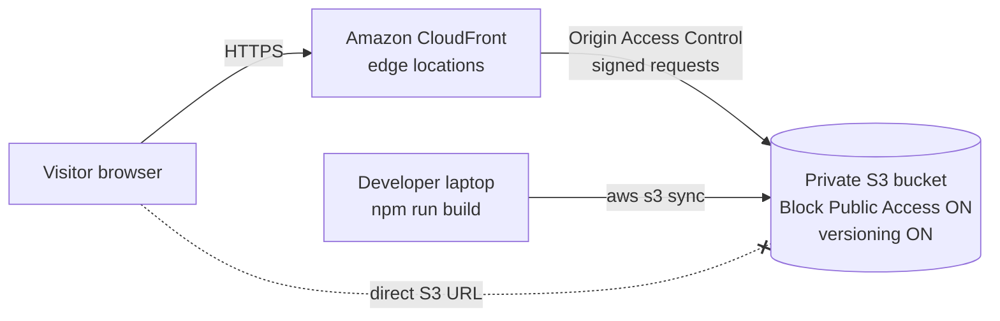

# Phase 1: Static Frontend on S3 and CloudFront

Part of **[Food Zone on AWS](../README.md)**, a hands-on project where one app grows from a static page to a containerized, auto scaling platform with CI/CD, Terraform and monitoring.

**Goal:** serve the Food Zone React app worldwide over HTTPS from a **private** S3 bucket, with CloudFront in front.

**Status:** ✅ Completed 21 Nov 2026 · **Region:** eu-north-1 (Stockholm) · **Cost:** a few cents per month


> The Food Zone React app is a sample application (source: [FoodZone](https://github.com/Lakshmankadali/FoodZone)). My work in this phase is the AWS hosting, configuration and troubleshooting.

---

## Architecture



- Visitors only reach the site through CloudFront.
- The bucket stays private: a direct S3 URL returns **AccessDenied**.
- CloudFront caches files at edge locations close to visitors and adds HTTPS.

---

## What I built

| Step | What I did | Why |
|---|---|---|
| Build | `npm ci` and `npm run build` to produce the `dist/` folder (91 files, 27.5 MiB) | S3 serves files; it can't run Node. Only the built output is deployed |
| Bucket | Created a private bucket with Block Public Access on and versioning enabled | Public buckets are a common cause of data leaks. Versioning allows recovery |
| Upload | `aws s3 sync dist s3://<bucket> --delete` | Uploads only changes and removes files that no longer exist in the build |
| CloudFront | Distribution with an S3 origin and **Origin Access Control (OAC)**, HTTP redirected to HTTPS | HTTPS, global caching, and the bucket stays private |
| Bucket policy | CloudFront added a policy allowing `cloudfront.amazonaws.com` to `s3:GetObject`, only for my distribution (`AWS:SourceArn`) | Other CloudFront distributions can't read my bucket |
| Routing | Custom error responses: 403 and 404 return `/index.html` with status 200 | React handles routes in the browser; S3 only has `index.html` |
| Cache | Invalidated `/index.html` after a deploy | CloudFront kept serving the old cached copy |
| Versioning | Deleted a file, then restored it by removing the delete marker | Proves recovery from accidental deletes |
| Lifecycle | Rule in [`lifecycle.json`](./lifecycle.json) | Controls storage cost from old versions |

---

## Commands

```powershell
# Build the React app
npm ci
npm run build

# Private, versioned bucket
aws s3 mb s3://<bucket> --region eu-north-1
aws s3api put-bucket-versioning --bucket <bucket> --versioning-configuration Status=Enabled
aws s3api get-public-access-block --bucket <bucket>      # all four settings: true

# Deploy
aws s3 sync dist s3://<bucket> --delete

# Clear the CloudFront cache for the changed page
aws cloudfront create-invalidation --distribution-id <distribution-id> --paths "/index.html"

# Check what CloudFront serves, without the browser cache
(Invoke-WebRequest https://<domain>.cloudfront.net/ -UseBasicParsing).Content | Select-String "<title>"

# Lifecycle rule
aws s3api put-bucket-lifecycle-configuration --bucket <bucket> --lifecycle-configuration file://lifecycle.json
```

---

## Problems I hit and how I solved them

| Problem | Cause | Fix |
|---|---|---|
| **403 AccessDenied on the root URL** of the CloudFront site | No default root object. CloudFront asked S3 for an empty key. With OAC, the distribution has `s3:GetObject` but not `s3:ListBucket`, so S3 returns 403 instead of 404 for a missing key | Set the default root object to `index.html` |
| **403 when refreshing `/veg`** (or any page other than home) | React uses client-side routing. Clicking a link changes the page in the browser, but a refresh asks CloudFront for a file called `veg`, which doesn't exist in S3 | Custom error responses for 403 and 404 that return `/index.html` with status 200. React then reads the URL and shows the right page |
| **Old page title after deploying a change** | CloudFront served its cached `index.html` | Invalidated `/index.html`. JS and CSS didn't need invalidating: Vite gives them new hashed file names on every build (cache busting) |

**Trade-off I'm aware of:** the error-page approach also turns a genuinely missing file into `index.html` with status 200, which can hide real errors. A cleaner option is a CloudFront Function that rewrites only extension-less paths to `/index.html`.

---

## Versioning: recovering a deleted file

```powershell
aws s3 rm s3://<bucket>/image/bg1.jpg                                     # "accidental" delete
aws s3api list-object-versions --bucket <bucket> --prefix image/bg1.jpg   # Versions + a DeleteMarker
aws s3api delete-object --bucket <bucket> --key image/bg1.jpg --version-id <delete-marker-id>
```

With versioning on, a delete only adds a **delete marker**. Removing the marker brings the file back.

**Rolling back a whole release** is different: restoring only an old `index.html` would point to JS files that `sync --delete` already removed, giving a blank page. The safe rollback is to redeploy the previous build (`git revert`, build, sync, invalidate).

---

## Lifecycle rule

| Setting | Effect |
|---|---|
| `NoncurrentVersionExpiration`: 30 days | Old versions are deleted 30 days after being replaced, keeping a 30-day restore window |
| `ExpiredObjectDeleteMarker` | Removes leftover delete markers |
| `AbortIncompleteMultipartUpload`: 7 days | Cleans up failed partial uploads |

I chose **expiry, not a Glacier transition**: for many small website files, per-object transition costs outweigh the savings. S3's own default (`TransitionDefaultMinimumObjectSize: all_storage_classes_128K`) doesn't transition objects under 128 KB for the same reason. Glacier fits large, rarely accessed data such as backups and archives.

---

## What I learned

- Why a private bucket behind CloudFront beats public S3 website hosting: security, HTTPS and caching.
- How OAC and a bucket policy with `AWS:SourceArn` limit access to one distribution.
- How client-side routing in a single-page app interacts with S3 and CloudFront.
- CDN caching, invalidations, and cache busting with hashed file names.
- `aws s3 sync --delete` vs `cp`, and why `npm ci` gives repeatable builds.
- Versioning, delete markers, and the difference between restoring a file and rolling back a release.
- Matching storage lifecycle rules to the size and access pattern of the data.

## Services used

Amazon S3 (versioning, Block Public Access, lifecycle) · Amazon CloudFront (OAC, custom error responses, invalidations) · AWS CLI · Node.js and npm (Vite build)

**Previous:** [Phase 0: Secure AWS account setup](../phase-0/README.md) · **Next:** [Phase 2: Run Food Zone on EC2](../phase-2/README.md)
