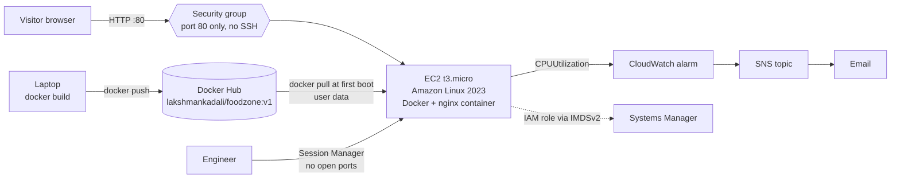

# Phase 2: Docker + EC2

Part of **[Food Zone on AWS](../README.md)**, a hands-on project where one app grows from a static page to a containerized, auto scaling platform with CI/CD, Terraform and monitoring.

**Goal:** package Food Zone as a Docker image and run it on an EC2 instance that configures itself at boot, with secure access, backups, monitoring, and practised failure recovery.

**Status:** ✅ Completed 24 Nov 2026 · **Region:** eu-north-1 (Stockholm) · **Cost:** a few cents (instance terminated after the phase)

> The Food Zone React app is a sample application (source: [FoodZone](https://github.com/Lakshmankadali/FoodZone)). My work in this phase is the containerization, AWS infrastructure, monitoring and troubleshooting.

---

## Architecture



---

## What I built

| Area | What I did | Why |
|---|---|---|
| Container | Two-stage Dockerfile: `node:22-alpine` builds, `nginx:stable-alpine` serves only `dist` | Final image 54 MB instead of several hundred: faster pulls, smaller attack surface |
| nginx | Custom `nginx.conf`: `/health` endpoint, SPA routing with `try_files`, long caching for hashed assets | Health checks for Docker and load balancers; React routes survive a refresh |
| Registry | Pushed `lakshmankadali/foodzone:v1` to Docker Hub, verified by deleting local copies and pulling | EC2 needs to download the image from somewhere it can reach |
| EC2 | t3.micro, Amazon Linux 2023, **user data** installs Docker and runs the container with `--restart always` | The server configures itself with no manual steps and recovers after reboots |
| Firewall | Security group allows only HTTP 80. **No SSH port** | Smallest possible exposure |
| Access | **Session Manager** through an IAM role with `AmazonSSMManagedInstanceCore` | No key pairs, no open port 22, IAM-controlled, sessions logged in CloudTrail |
| Credentials | Inspected the role's temporary credentials through **IMDSv2** (`ASIA...` key with an expiry) | Understand how instance roles avoid long-term keys |
| Backups | EBS snapshot and an AMI (`foodzone-web-v1`); launched a copy from the AMI with no user data | Recovery and identical servers for later auto scaling |
| IP addressing | Observed public IP change on stop/start; attached and released an Elastic IP | Understand why production uses DNS and load balancers instead of server IPs |
| Monitoring | CloudWatch alarm on CPU > 70% → SNS topic → email; triggered it with `stress-ng` | Alerts that are proven to work |

Files: [`Dockerfile`](https://github.com/Lakshmankadali/FoodZone/blob/main/Dockerfile), [`nginx.conf`](https://github.com/Lakshmankadali/FoodZone/blob/main/nginx.conf), [`.dockerignore`](https://github.com/Lakshmankadali/FoodZone/blob/main/.dockerignore) (in the FoodZone repo)

---

## User data

```bash
#!/bin/bash
dnf install -y docker
systemctl enable --now docker
docker run -d --name foodzone --restart always -p 80:80 lakshmankadali/foodzone:v1
```

Bootstrap (user data) vs bake (AMI): user data installs at every first boot and is easy to change; an AMI starts faster because everything is pre-installed. I used user data to build the server, then baked an AMI from it.

---

## Break-and-fix scenarios

I broke the setup on purpose and troubleshot it in order, without guessing.

### 1. Website stopped loading

| | |
|---|---|
| Break | Removed the port 80 inbound rule from the security group |
| Symptom | Browser **timed out** (not "connection refused"), pointing to a firewall drop |
| Investigation | Instance running → `curl localhost/health` from inside via Session Manager returned `ok` → app healthy, problem outside → security group had no inbound rules |
| Fix | `aws ec2 authorize-security-group-ingress ... --port 80 --cidr 0.0.0.0/0`. Recovered immediately, no restart |

### 2. Session Manager could not connect

| | |
|---|---|
| Break | Detached the IAM instance profile and rebooted (to clear cached credentials) |
| Symptom | Website still worked, but Session Manager could not connect |
| Investigation | `aws ssm describe-instance-information` still showed **Online** at first, but `LastPing` had stopped updating; later **ConnectionLost**. Instance had no instance profile |
| Fix | `aws ec2 associate-iam-instance-profile` + reboot → Online, connected |
| Lesson | Dashboards lag. Check when a status was last updated, not only the status |

### 3. Root disk 89% full

| | |
|---|---|
| Break | `fallocate -l 5G /bigfile` filled the 8 GiB disk to 89% |
| Fix | `aws ec2 modify-volume --size 10` while running → inside the OS: `growpart /dev/nvme0n1 1` and `xfs_growfs -d /` → 10 GiB, no downtime |
| Lesson | Growing the EBS volume isn't enough; the partition and filesystem must be extended too. Volumes can't be shrunk |

---

## Other problems I hit

| Problem | Cause | Fix |
|---|---|---|
| `describe-instances` returned nothing | CLI default Region was still `ap-south-1` from an old config file | `aws configure set region eu-north-1`; empty output usually means wrong Region or filter |
| `docker build` failed: `.lock` Access is denied | Docker had once run as Administrator, so the user didn't own `.docker` | `icacls` to restore permissions; daily work in a normal terminal |
| Image pushed to a misspelled repository | Typo in `docker tag` | Re-tagged, pushed, deleted the wrong repository. Pipelines take names from variables |
| `stress-ng` failed: temp path not writable | Session Manager starts in `/`, which `ssm-user` can't write to | Ran it from `/tmp` |
| Console suggested opening port 22 | EC2 Instance Connect tab | Used the Session Manager tab; port 22 stays closed |
| An unnamed extra instance was running | Launched from the AMI twice, once without a Name tag | Terminated by ID. Every resource gets a Name tag |

---

## Clean-up

Terminated the instance, deleted the manual snapshot, the alarm and the security group. Kept the AMI (for Phases 3 and 4), the SNS topic and the IAM role.

---

## What I learned

- Images vs containers, multi-stage builds, layer caching, port mapping, health checks.
- Bootstrapping servers with user data and baking AMIs.
- Session Manager instead of SSH, and how instance roles deliver temporary credentials through IMDSv2.
- EBS volumes, snapshots and AMIs, and online volume resizing.
- Public vs Elastic IPs and their cost.
- CloudWatch alarms with SNS, and testing alerts on purpose.
- Troubleshooting in order: symptom → layer by layer → root cause → fix → verify.

## Services and tools used

Docker · Docker Hub · nginx · Amazon EC2 · Amazon EBS · AMIs · Elastic IP · Security groups · IAM roles and instance profiles · IMDSv2 · AWS Systems Manager Session Manager · Amazon CloudWatch · Amazon SNS · AWS CLI · Linux (Amazon Linux 2023)

**Previous:** [Phase 1: Static frontend on S3 and CloudFront](../phase-1/README.md) · **Next:** [Phase 3: Your own VPC](../phase-3/README.md)
