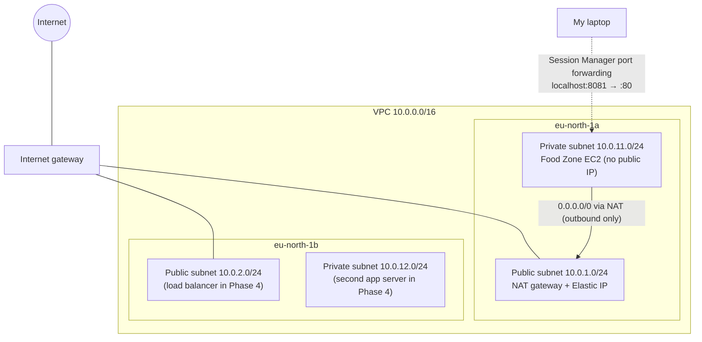

# Phase 3: Custom VPC with Public and Private Subnets

Part of **[Food Zone on AWS](../README.md)**, a hands-on project where one app grows from a static page to a containerized, auto scaling platform with CI/CD, Terraform and monitoring.

**Goal:** move Food Zone off the default VPC into a network I designed, with the application server in a private subnet that has no public IP and reaches the internet only outbound through a NAT gateway.

**Status:** ✅ Completed 25 Nov 2026 · **Region:** eu-north-1 (Stockholm) · **Cost:** NAT gateway and Elastic IP for a few hours, deleted the same day

---

## Architecture

| Route table | Routes | Associated subnets |
|---|---|---|
| `foodzone-public-rt` | `10.0.0.0/16 → local`, `0.0.0.0/0 → internet gateway` | Public A, Public B |
| `foodzone-private-rt` | `10.0.0.0/16 → local`, `0.0.0.0/0 → NAT gateway` | Private A, Private B |

---

## What I built

| Area | What I did | Why |
|---|---|---|
| IP plan | VPC `10.0.0.0/16`; public `10.0.1.0/24`, `10.0.2.0/24`; private `10.0.11.0/24`, `10.0.12.0/24`; gap left for growth | Non-overlapping ranges; public vs private readable from the address. Each `/24` gives 251 usable IPs (AWS reserves 5) |
| Two AZs | One public and one private subnet in each of `eu-north-1a` and `eu-north-1b` | Ready for high availability in Phase 4 |
| Public subnets | Internet gateway + route `0.0.0.0/0 → igw`, auto-assign public IP | A subnet is public because of its route, not its name |
| Private subnets | Route `0.0.0.0/0 → NAT gateway`; no public IPs | Outbound access for updates and AWS APIs, no inbound exposure |
| Security group | `foodzone-app-sg`: TCP 80 only from `10.0.0.0/16` | Only resources inside the VPC (later the load balancer) can reach the app |
| App server | Launched from my Phase 2 AMI into the private subnet, with the SSM instance role | The baked AMI already contains Docker and the container, so it serves without internet access |
| Private access | Session Manager shell and **port forwarding** (`localhost:8081 → instance:80`) | Reach a private instance with no public IP, no bastion host and no open ports |
| NAT proof | Inside the instance `hostname -I` showed `10.0.11.x`; `curl checkip.amazonaws.com` showed the NAT's Elastic IP | Seeing address translation happen |

All resources were created with the AWS CLI and named with tags. [`foodzone-vars.ps1`](./foodzone-vars.ps1) reloads every ID by its Name tag in a new terminal.

---

## Security group vs network ACL: tested

| | Security group | Network ACL |
|---|---|---|
| Level | Instance | Subnet |
| State | **Stateful**: return traffic allowed automatically | **Stateless**: every packet checked in both directions |
| Rules | Allow only | Allow and deny, evaluated by rule number |

**Test:** I attached a custom NACL to the private subnet that allowed all outbound traffic and nothing inbound. A Session Manager window opened (the browser talks to AWS) but froze: replies to the instance's ephemeral ports were dropped. Adding an inbound rule for TCP 1024 to 65535 and reconnecting fixed it. I then restored the default NACL and deleted the test one.

---

## Problems I hit and how I solved them

| Problem | Cause | Fix | Lesson |
|---|---|---|---|
| Private instance stayed offline in Systems Manager even with a NAT gateway | The private route table was never created: an empty PowerShell variable made the command fail silently | Checked the chain link by link (NAT available, public subnet → IGW, private subnet's route table) and created the route table with the NAT route | Verify each link; print every variable after creating it |
| `associate-route-table` failed with `Resource.AlreadyAssociated` | A subnet can have only one route table association | Found the existing association ID and used `replace-route-table-association` | Replace, don't add |
| Commands failed with `None` / `expected one argument` | A new terminal had lost all variables | Wrote `foodzone-vars.ps1` to look up IDs by tag | Name every resource; never rely on session state |
| With the blocking NACL attached, the console still showed the instance as Online | Systems Manager status lags behind reality | Tested by actually typing in a session | Trust a real test over a dashboard |
| After the NACL fix the session was still frozen | The old connection had already broken | Rebooted and opened a new session | Reconnect after fixing a network rule |

---

## Clean-up

Terminated the instance, deleted the NAT gateway, released the Elastic IP and removed the NAT route. Kept the VPC, subnets, internet gateway, route tables and security group (no cost) for Phase 4.

---

## What I learned

- CIDR notation and IP planning, including AWS's 5 reserved addresses per subnet.
- What makes a subnet public or private, and route table evaluation (`local` route, most specific match).
- Internet gateway vs NAT gateway, and why the NAT gateway lives in a public subnet.
- Stateful security groups vs stateless network ACLs, including ephemeral ports.
- Reaching private instances securely with Session Manager and port forwarding.
- Systematic troubleshooting along a network path.

## Services and tools used

Amazon VPC · Subnets · Route tables · Internet gateway · NAT gateway · Elastic IP · Security groups · Network ACLs · Amazon EC2 · AWS Systems Manager Session Manager (port forwarding) · AWS CLI · PowerShell

**Previous:** [Phase 2: Docker + EC2](../phase-2/README.md) · **Next:** [Phase 4: High availability with ALB and Auto Scaling](../phase-4/README.md)
